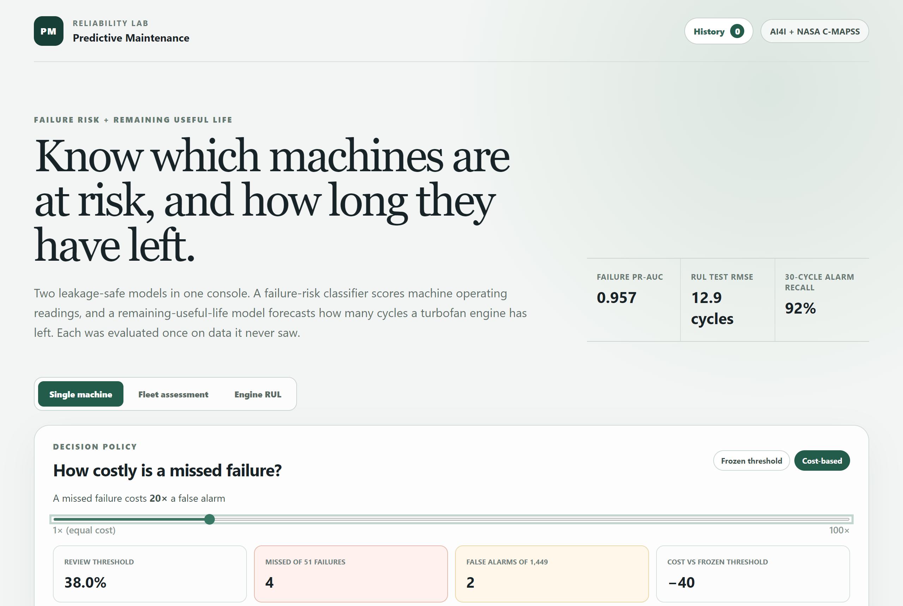
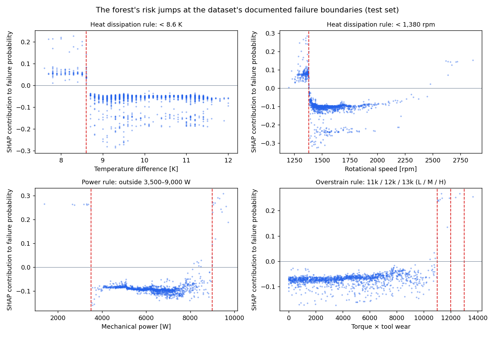
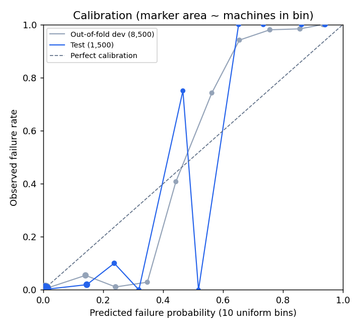
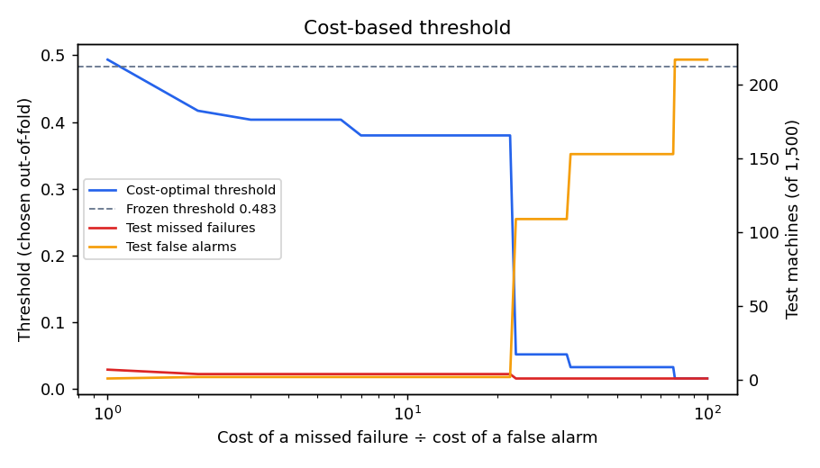
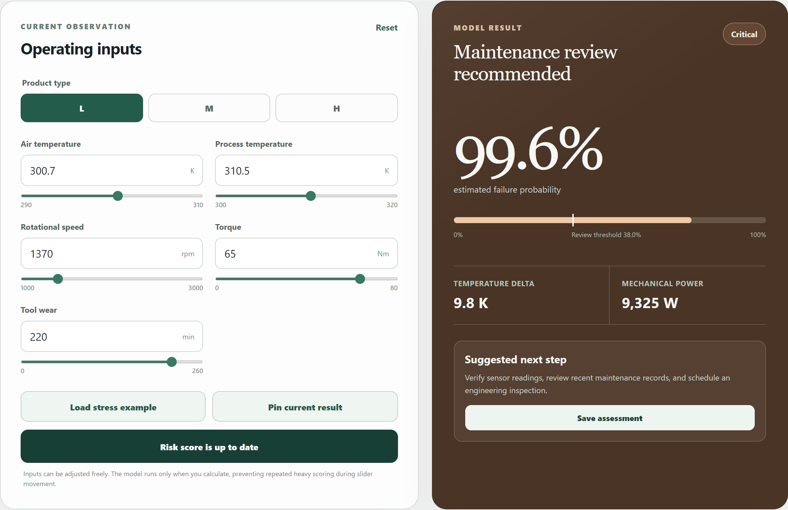
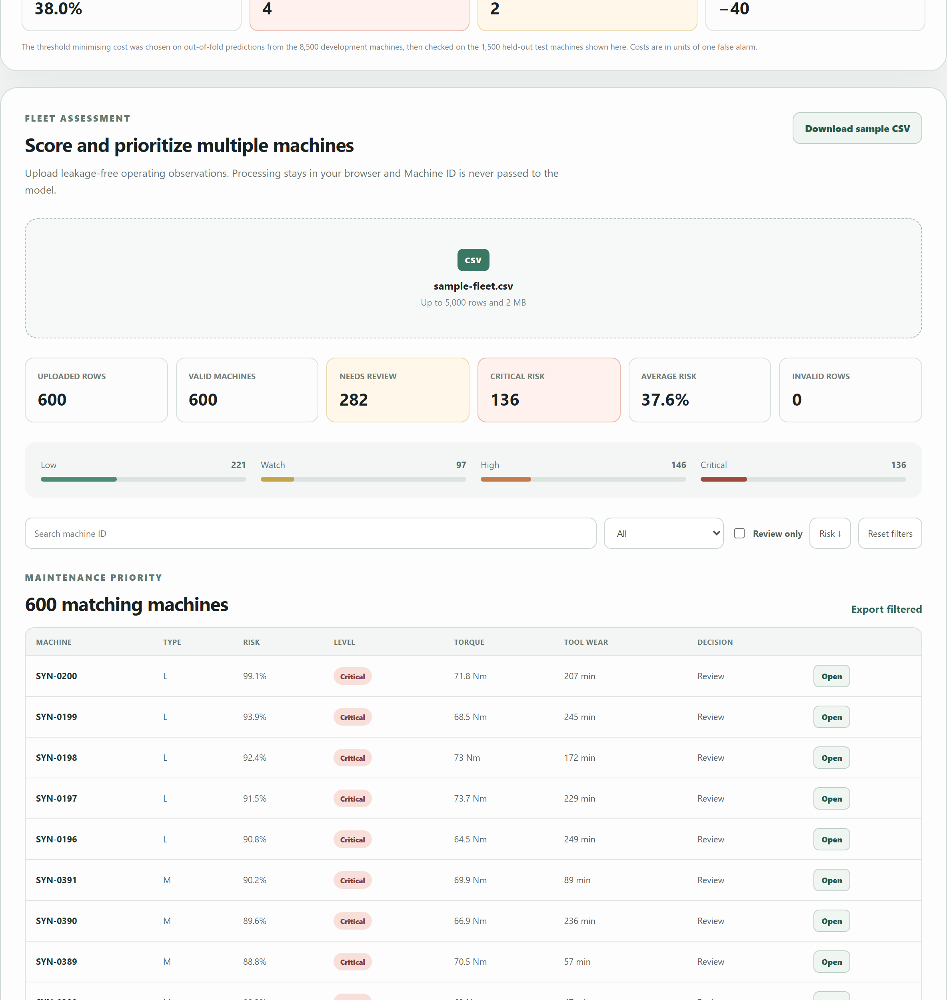
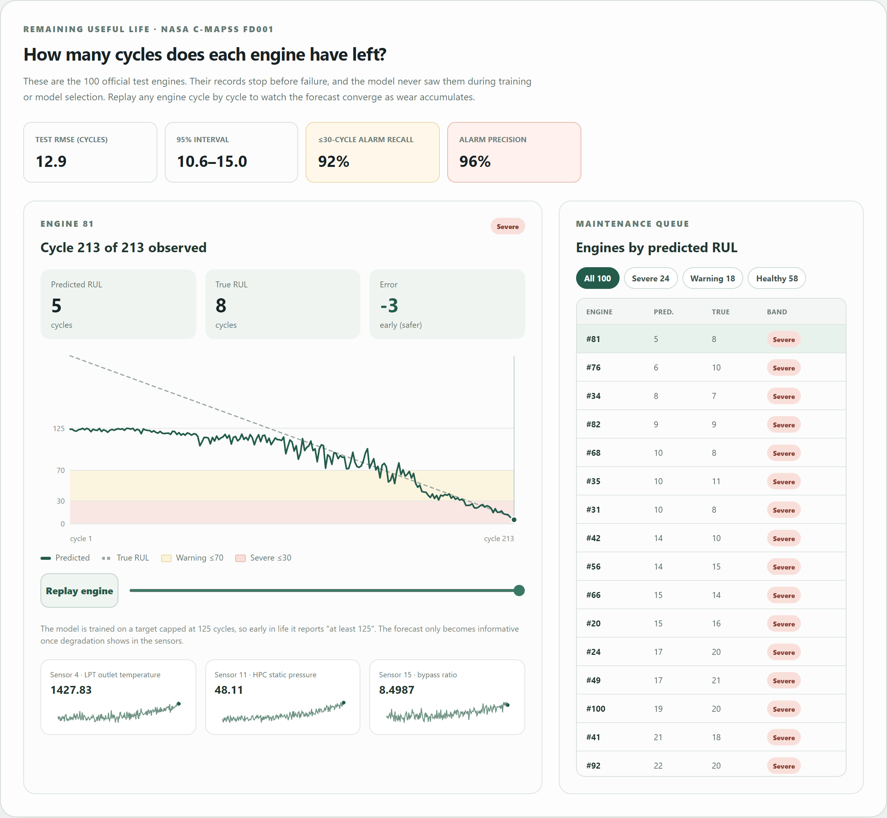
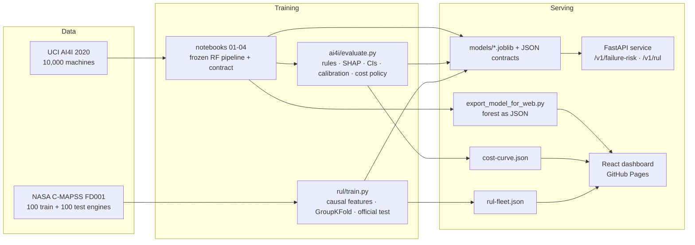

# Predictive Maintenance Platform

[](https://github.com/neilss170/predictive-maintenance-platform/actions/workflows/ci.yml)

Two maintenance questions, each answered by a model evaluated once on data it never saw:

- **Which machines are about to fail?** A failure-risk classifier on the UCI AI4I 2020 dataset, with a decision threshold you can set from what a missed failure costs.
- **How long does this engine have left?** A remaining-useful-life (RUL) regressor on NASA's C-MAPSS FD001 turbofan engines, scored on the official test set.

Both models are served by one FastAPI service (packaged with Docker) and explored through a React dashboard that runs the classifier entirely in the browser.

**Live demo:** https://neilss170.github.io/predictive-maintenance-platform/



## Headline results

| Model | Test set | Result | Best baseline |
|---|---|---|---|
| Remaining useful life (gradient boosting) | 100 official FD001 test engines | **RMSE 12.85 cycles** (95% CI 10.6–15.0), MAE 9.06, NASA score 224 | Random forest 13.50 · ridge 17.04 · predicting the mean 43.07 |
| 30-cycle failure alarm (from the RUL model) | Same 100 engines, 25 due within 30 cycles | **Precision 0.96** (0.86–1.00), **recall 0.92** (0.79–1.00) | — |
| Failure risk (random forest) | 1,500 held-out machines, 51 failures | **PR-AUC 0.957** (0.904–0.994), precision 0.957, recall 0.882 | Documented failure rules: precision 1.00, recall 0.92 |
| Calibration (same classifier) | Same 1,500 machines | **Brier 0.0059** vs 0.0328 for predicting the base rate | — |

The ranges are 95% bootstrap intervals over test engines or machines. The test sets are small (25 engines due within 30 cycles, 51 failed machines), and the wide ranges reflect that.

## What makes the evaluation trustworthy

**Remaining useful life (NASA C-MAPSS FD001)**
- **Split by engine.** Model selection uses 5-fold `GroupKFold` over the 100 training engines, so no engine contributes rows to both sides of a fold. (The project this replaces split rows at random, which put the same engine in train and test.)
- **Official test set, scored once.** All 100 test engines are scored at their last observed cycle against NASA's `RUL_FD001` labels, uncapped. A test checks the labels match the official file.
- **No information from future cycles.** Features (rolling mean, spread, 20-cycle trend, and drift from each engine's early-life level) use only cycles already seen. A test truncates histories and checks earlier features don't change.
- **Cross-validation that predicts test performance.** Scoring validation engines at random cut-off points, like the test set, gives RMSE 12.56. The test RMSE against capped truth is 11.63, so cross-validation was slightly pessimistic, not optimistic.
- **Selection by cross-validation only.** A shallower boosting variant scored marginally better on test (12.77 vs 12.85). It is reported but was not chosen, because it lost on cross-validation.

**Failure risk (UCI AI4I 2020)**
- **No leakage.** Identifiers and the five failure-mode columns (`TWF`, `HDF`, `PWF`, `OSF`, `RNF`) are excluded from the model's inputs. The 70/15/15 split stays sealed until the pipeline and threshold are frozen.
- **Rule-based baseline.** AI4I is synthetic, and its documentation states the formulas behind three failure modes. These rules reproduce the dataset's labels on all 10,000 rows. On test, the rules alone reach F1 **0.959** against the forest's **0.918**. The forest gets close to the formula that generated the data but doesn't beat it. That ceiling only exists because the data is synthetic.
- **SHAP shows the model learned those rules.** The forest's risk jumps exactly at the documented boundaries: a temperature gap below 8.6 K, speed below 1,380 rpm, power outside 3,500–9,000 W, and overstrain at 11k/12k/13k for L/M/H machines. It catches 20/20 power failures, 12/12 overstrain failures and 15/17 heat-dissipation failures, but 0/3 random tool-wear failures.
- **Cost-based threshold.** For a chosen ratio of missed-failure cost to false-alarm cost, the threshold minimises total cost on out-of-fold predictions from the 8,500 development rows, and only then is checked on test. At 20:1 it misses 4 failures with 2 false alarms (frozen threshold: 6 and 2). From about 23:1 upward it accepts over 100 false alarms to save 3 more misses.



<details>
<summary>Calibration and cost-threshold charts</summary>




</details>

## Dashboard

| Single machine | Fleet assessment | Engine RUL |
|---|---|---|
|  |  |  |

- **Decision policy.** A slider sets how much worse a missed failure is than a false alarm. The review threshold, and every score on the page, update to match, with the held-out test outcome shown beside it.
- **Single machine.** Adjust the operating readings, compare against a pinned scenario, and save assessments.
- **Fleet assessment.** Upload up to 5,000 machines as CSV. Files with leakage columns are rejected and invalid rows are reported. Results can be filtered, sorted and exported. A [600-machine sample](dashboard/public/sample-fleet.csv) is included.
- **Engine RUL.** Replay any of the 100 test engines cycle by cycle, with predicted and true RUL and the key sensors, and see the fleet ranked into severe, warning and healthy bands.

The 500-tree forest is exported to JSON and scored in the browser. A parity check confirms the browser model matches scikit-learn to within 2e-16.

## Architecture



## Run it

**API (Docker)**

```bash
docker build -t pm-platform .
docker run -p 8000:8000 pm-platform
# Interactive docs at http://localhost:8000/docs
curl -X POST "localhost:8000/v1/failure-risk?cost_ratio=20" -H "content-type: application/json" \
  -d '{"type":"L","air_temperature":300.7,"process_temperature":310.5,"rotational_speed":1370,"torque":65,"tool_wear":220}'
```

| Endpoint | Purpose |
|---|---|
| `POST /v1/failure-risk` | One machine's failure probability and decision. Optional `?cost_ratio=1..100` swaps in the cost-based threshold. |
| `POST /v1/failure-risk/batch` | Up to 5,000 machines in one call. |
| `POST /v1/rul` | Remaining useful life from an engine's cycle-by-cycle sensor history. Cycles must be unique and increasing. |
| `GET /v1/models` | Both model contracts and their test metrics. |
| `GET /health` | Readiness. |

Inputs are validated: unknown fields such as failure-mode labels are rejected, the product type must be L, M or H, temperatures must be positive, and speed, torque and wear can't be negative.

**Dashboard**

```bash
cd dashboard
npm ci
npm run dev        # http://localhost:5173
npm test
```

**Reproduce the models and reports** (Python 3.11)

```bash
pip install -r requirements.txt
python -m rul.train          # RUL model, reports/rul_*.{json,csv}, dashboard/public/rul-fleet.json
python -m ai4i.evaluate      # reports/ai4i_evaluation.json, figures, cost policy
python export_model_for_web.py && python validate_web_model.py
python -m pytest -q
```

The AI4I pipeline itself is produced by `notebook/01`–`04` (cleaning, EDA, feature engineering, modelling) and is not retrained by the scripts above.

## Repository layout

```text
ai4i/           rule baseline and deeper evaluation of the frozen classifier
rul/            FD001 loading, causal features, training and evaluation
api/            FastAPI service for both models
notebook/       AI4I analysis notebooks 01–04
models/         frozen pipelines, JSON contracts, cost policy
reports/        test metrics, CV comparison, figures
dashboard/      React + Vite app (browser-side forest, RUL playback)
tests/          Python tests (data, features, models, API)
.github/        CI (Python, dashboard, container) and Pages deploy
```

## Limitations

- **Both datasets are simulated.** AI4I is synthetic and its failures follow known formulas; C-MAPSS is a turbofan simulator. Neither result shows how the models would do on a real fleet, which would need new validation on time-stamped equipment data.
- **AI4I has no time or machine identity.** The split is stratified at random, not chronological or grouped by machine. This project also reset the split after earlier iterations had looked at the data, so the test set is "sealed since the reset", not truly external.
- **The rules beat the model on AI4I.** On real equipment no such formula exists. Here it is an upper bound, showing the forest recovers most of the structure, not a competitor to deploy.
- **The RUL model covers FD001 only:** one operating condition and one fault mode. The other C-MAPSS subsets (FD002–FD004) add operating regimes and a second fault mode, and would need regime normalisation.
- **RUL predictions are capped at 125 cycles,** so a healthy engine reads "at least 125", and errors against uncapped truth grow for engines far from failure.
- **Mid-range failure probabilities are poorly calibrated.** Overall calibration is good (expected calibration error 0.017), but few machines fall between 0.2 and 0.6, and those bins are noisy. Read scores there as a ranking, not a probability.
- **The costs are relative.** The slider assumes you can put a ratio on a missed failure versus a false alarm. The real ratio has to come from the maintenance owner.
